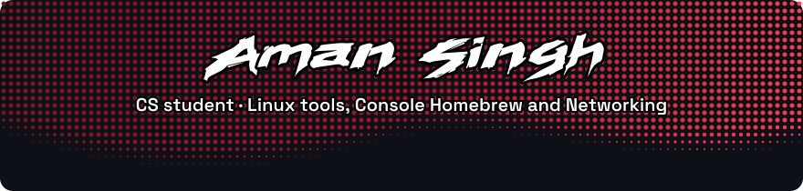
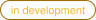
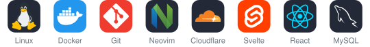

  

  

  
  

---

### About me

I'm Aman. I'm a computer science student. I build tools that are useful to me, like Linux desktop apps, homebrew for my PS4, a home server that runs my media and DNS, and some security tooling for bug bounty work. I also like contributing to open source.

### Projects

<table>
  <tr>
    <td colspan="2" width="33%" valign="top">
      <b>Home server</b> 
      <code>Go</code> <code>Svelte</code> <code>Docker</code>  
      An old computer turned into an always-on Ubuntu server. I built <b>ykhub</b>, its dashboard: live stats, logs, one-click fixes, phone alerts and an apps page. It runs Jellyfin, AdGuard Home (ad blocking for all my devices), Uptime Kuma, and qBittorrent behind ProtonVPN with a kill switch, all reachable only over Tailscale.
    </td>
    <td colspan="2" width="33%" valign="top">
      <b>Gold Torrent</b>  
      <code>C++</code> <code>libtorrent</code>  
      A torrent client for jailbroken PS4s. Downloads keep going in the background, with the app closed or mid-game, and pick up again after a power cut. Add torrents from your phone through a PIN-locked web page. v0.3 runs on my console; 0.4 adds seeding, USB drives and in-app updates.
    </td>
    <td colspan="2" width="33%" valign="top">
      <b><a href="https://github.com/amansingh909/keyglow">keyglow</a></b> 
      <code>Rust</code> <code>egui</code>  
      Layered RGB lighting for Razer keyboards on Linux. Stacks effects the way Chroma Studio does on Windows, on top of OpenRazer.
    </td>
  </tr>
  <tr>
    <td colspan="3" width="50%" valign="top">
      <b><a href="https://github.com/amansingh909/gamepad-media-center-aggregator">GMCA for PS4</a></b>  
      <code>C++</code> <code>libtorrent</code>  
      A gamepad media center for Plex, Jellyfin, Emby and Stremio. In my fork I ported libtorrent to the PS4, so Stremio torrents stream right on the console with no PC. It also adds HDR video, subtitles, USB drives, Continue Watching synced with Stremio, and one-tap in-app updates. 9 releases, 880+ downloads.
    </td>
    <td colspan="3" width="50%" valign="top">
      <b>REDLINE</b> 
      <code>Python</code> <code>Textual</code> <code>Ollama</code>  
      A terminal cockpit for chatting with local AI models through Ollama. Its main trick is a thinking switch on every message, so a reasoning model can answer fast or think it through, something the other Ollama apps I tried couldn't do. Saved sessions, quick model switching and a command palette.
    </td>
  </tr>
</table>

### Open source contributions

| Project | What I did |
| --- | --- |
| [thcolin/gamepad-media-center-aggregator](https://github.com/thcolin/gamepad-media-center-aggregator) Gamepad media center for Plex, Jellyfin and Stremio | Fixed up the PS4 build: HDR video, subtitles, USB drives, crash fixes. 6 PRs merged, 4 more open (in-app updates, Stremio streams). |
| [erikwb/blueferry](https://github.com/erikwb/blueferry) iMessage and SMS on Linux over Bluetooth | Added a quick-reply box to message popups, plus a Bluetooth fallback. 2 PRs merged. |
| [zenvyzenshiro/NXNativeWindows](https://github.com/zenvyzenshiro/NXNativeWindows) | Linux build support. Merged. |
| [openrazer/openrazer.github.io](https://github.com/openrazer/openrazer.github.io) | Adding keyglow to the OpenRazer apps list. Open. |

### Tools

   
  

### Activity

  

  

