

  

  

  
  

---

### About me

I'm Aman. I'm a computer science student. I build tools that are useful to me, like Linux desktop apps, homebrew for my PS4, a home server that runs my media and DNS, and some security tooling for bug bounty work. I also like contributing to open source.

### Projects

  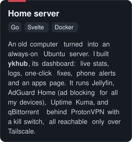
  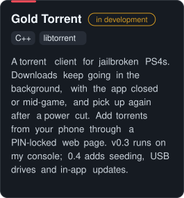
  <a href="https://github.com/amansingh909/keyglow">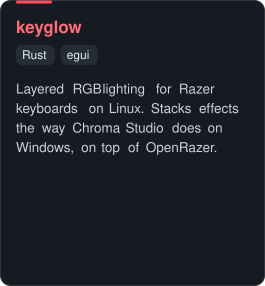</a>
   
  <a href="https://github.com/amansingh909/gamepad-media-center-aggregator">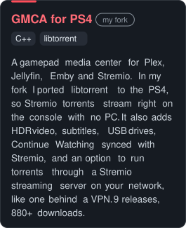</a>
  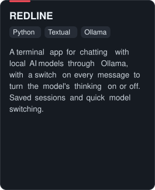

### Open source contributions

| Project | What I did |
| --- | --- |
| [GMCA](https://github.com/thcolin/gamepad-media-center-aggregator) Gamepad media center | Fixed up the PS4 build: HDR video, subtitles, USB drives, crash fixes. 6 PRs merged, 4 more open (in-app updates, Stremio streams). |
| [BlueFerry](https://github.com/erikwb/blueferry) iMessage on Linux | Added a quick-reply box to message popups, plus a Bluetooth fallback. 2 PRs merged. |
| [NXNative](https://github.com/zenvyzenshiro/NXNativeWindows) Windows port | Linux build support. Merged. |
| [OpenRazer](https://github.com/openrazer/openrazer.github.io) Project website | Adding keyglow to the OpenRazer apps list. Open. |

### Tools

  <a href="https://www.rust-lang.org">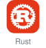</a><a href="https://isocpp.org">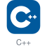</a><a href="https://www.python.org">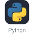</a><a href="https://www.typescriptlang.org">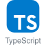</a><a href="https://www.gnu.org/software/bash/">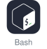</a><a href="https://dev.java">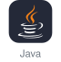</a> 
  <a href="https://kernel.org">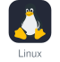</a><a href="https://www.docker.com">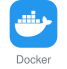</a><a href="https://neovim.io">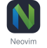</a><a href="https://react.dev">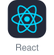</a><a href="https://www.mysql.com">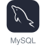</a>

### Activity

  <picture>
    <source media="(max-width: 600px)" srcset="profile-3d-contrib/profile-red-portrait.svg">
    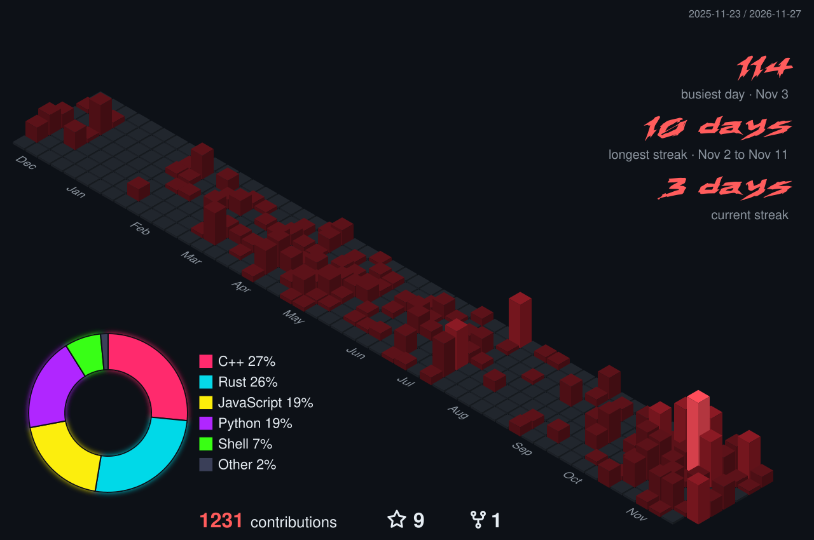
  </picture>

  

